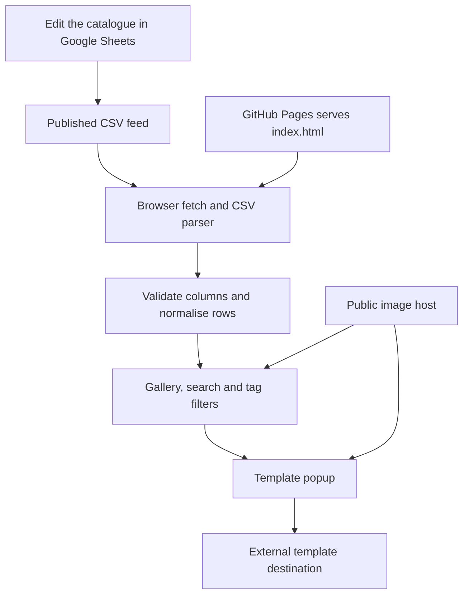

<div align="center">

# OFFSCRIPT®

**A curated CV template gallery by NotNahid.**

Browse the design. Open the template. Make it yours.


[Publish the site](#publish-on-github-pages) · [Manage templates](#manage-the-google-sheet) · [Customise](#customise-the-site) · [Troubleshoot](#troubleshooting)

</div>

---

## Start here

The website is **`index.html`**. All application CSS, JavaScript, icons, effects, and the favicon are embedded in it. Template records are fetched directly from a published Google Sheets CSV; preview images are loaded from the URLs in that sheet.

**No npm install, build command, API key, database, or application server is needed.** An internet connection is required for the live catalogue and externally hosted previews.

The current file is already connected to Notnahid's published catalogue. To launch, upload the package contents to a GitHub repository and enable Pages. To reuse the site with another catalogue, replace `SHEET_URL` in `index.html`.

> This package is ready to upload. It has not created a repository or published a live GitHub Pages URL for you.

<details>
<summary><strong>Jump to a section</strong></summary>

- [What the site does](#what-the-site-does)
- [Files in this package](#files-in-this-package)
- [Publish on GitHub Pages](#publish-on-github-pages)
- [Run locally](#run-locally)
- [Manage the Google Sheet](#manage-the-google-sheet)
- [How live updates work](#how-live-updates-work)
- [Customise the site](#customise-the-site)
- [Interaction guide](#interaction-guide)
- [Architecture](#architecture)
- [Performance and compatibility](#performance-and-compatibility)
- [Troubleshooting](#troubleshooting)
- [Before sharing](#before-sharing)
- [Maintenance](#maintenance)
- [Credits and licensing](#credits-and-licensing)

</details>

## What the site does

| Feature | Behaviour |
| --- | --- |
| Catalogue | Shows the title, tags, and preview image from each non-empty sheet row. |
| Search | Searches titles, descriptions, and tags. |
| Tag filters | Builds the available filters from your actual tags; comparisons ignore case. |
| Template popup | Enlarges the preview and displays the description and tags. |
| Preview navigation | Steps through the current filtered results; unavailable directions are disabled. |
| Template link | Opens the row's link in a new tab. Overleaf destinations say “Use in Overleaf”; other valid web links say “Open template”. |
| Live data | Fetches on page load, polls every 30 seconds while visible, and checks again when the visitor returns. |
| Themes | Light and dark palettes; the theme choice is stored in the visitor's browser when local storage is available. |
| Phone navigation | A filter drawer with curved SVG hamburger motion, focus handling, and an apply button. |
| Feedback | Loading, empty-result, retry, missing-link, and broken-image states. |

The site is a gallery and template launcher. CV editing and PDF compilation happen in Overleaf or whichever destination you provide. It does not compile LaTeX, edit CVs, collect CV data, or contain user accounts.

## Files in this package

| File | Purpose | Upload to your repository? |
| --- | --- | --- |
| `index.html` | Complete working website, with the connected catalogue URL. | **Yes, at the repository root.** |
| `README.md` | This guide, rendered automatically on the repository page. | Yes. |
| `.nojekyll` | Empty file telling Pages to serve these static files without Jekyll processing. | Yes. |
| `sheet-template.csv` | Header-only starter for creating another catalogue. | Optional; the app does not fetch this local file. |

There is no `dist` directory, package manager, node modules, preview harness, or development server bundled with this release. The SVG favicon is embedded: you do not need a separate `favicon.ico`.

## Publish on GitHub Pages

### Recommended: a separate project repository

1. Sign into [GitHub](https://github.com/) and create a repository. Suggested name: **`offscript`**. Choose **Public** when using GitHub Free.
2. Extract the ZIP on your computer.
3. Open the extracted `offscript-github-pages` folder. Upload **the files inside it**, rather than uploading the ZIP or nesting the whole folder in the repository.
4. Confirm that `index.html` is visible at the top level on your repository's default branch.
5. Open **Settings → Pages**.
6. Under **Build and deployment**, choose **Deploy from a branch**.
7. Select **`main`** and **`/ (root)`**, then **Save**. If your default branch has another name, select that actual branch.
8. Wait for the deployment to finish. Use the URL shown by GitHub Pages; the repository's **Actions** tab shows deployment progress or errors.

**Example address, if the repository is `NotNahid/offscript`:**

```text
https://notnahid.github.io/offscript/
```

This is an expected address for that example repository, not a confirmation that it is already published.

Official guides: [publish from a branch](https://docs.github.com/en/pages/getting-started-with-github-pages/configuring-a-publishing-source-for-your-github-pages-site), [create a Pages site](https://docs.github.com/en/pages/getting-started-with-github-pages/creating-a-github-pages-site), [Pages availability and limits](https://docs.github.com/en/pages/getting-started-with-github-pages/github-pages-limits).

<details>
<summary><strong>Already have a notnahid.github.io portfolio?</strong></summary>

Keep this project in its own `offscript` repository. It can have its own project Pages site without replacing your portfolio's root `index.html`.

Alternatively, you can place the site in an `offscript` subfolder of an existing Pages source, if that is how you want to manage it. Avoid putting this site's `index.html` over your portfolio's root file.

Follow the deployment method already used by that repository if it uses a framework or GitHub Actions. The simple branch instructions above apply directly to a dedicated repository containing this package.

</details>

<details>
<summary><strong>Prefer Git commands?</strong></summary>

Create the empty repository on GitHub first. Open a terminal inside the extracted folder and run:

```bash
git init
git add index.html README.md .nojekyll sheet-template.csv
git commit -m "Add Offscript CV gallery"
git branch -M main
git remote add origin https://github.com/YOUR_USERNAME/offscript.git
git push -u origin main
```

Replace `YOUR_USERNAME` and the repository name as needed. Then enable Pages using **Settings → Pages → Deploy from a branch → main → / (root)**.

If the folder is already a Git checkout, use its existing remote and branch rather than running the initialisation commands again.

</details>

<details>
<summary><strong>Can I use another host or a custom domain?</strong></summary>

Yes. The same `index.html` can be served by ordinary HTTPS static hosting. There is no server runtime or build output to configure.

For a GitHub Pages custom domain, follow [GitHub's custom domain documentation](https://docs.github.com/en/pages/configuring-a-custom-domain-for-your-github-pages-site). Configure the host and DNS for the domain you own. This package intentionally contains no `CNAME` file or assumed domain.

</details>

## Run locally

For reliable live-data testing, serve the folder over HTTP. Python is only a local preview tool; visitors and GitHub Pages do not need it.

**Windows, with Python installed:**

```powershell
cd "C:\path\to\offscript-github-pages"
py -m http.server 8000
```

**macOS / Linux:**

```bash
cd /path/to/offscript-github-pages
python3 -m http.server 8000
```

Open [http://localhost:8000](http://localhost:8000). Stop the server with **Ctrl+C**.

You can also try opening `index.html` directly. Browser restrictions on requests from `file://` pages can vary, so use the HTTP method above if the catalogue does not load.

## Manage the Google Sheet

### The five-column contract

Create a tab such as **Templates**. Put these exact headings in row 1, then use one row per CV starting at row 2:

| Column | Header | Example content |
| --- | --- | --- |
| A | `Title` | `Blue Standard` |
| B | `Tags` | `Bold, Creative, With photo` |
| C | `Description` | `A two-column layout with bold typography.` |
| D | `Preview Image` | A public HTTPS URL pointing directly to the image. |
| E | `Overleaf Link` | The full URL to the template or its public copy/view destination. |

Copy this header line into cell A1, or import `sheet-template.csv`:

```tsv
Title	Tags	Description	Preview Image	Overleaf Link
```

**How rows are interpreted:**

- A blank title means the row is skipped.
- Tags are separated by commas. Keep their wording consistent for a tidy filter list.
- Descriptions can contain punctuation, commas, or line breaks. The CSV reader supports quoted cells and escaped quotes.
- New tags appear automatically; you do not need to add filter buttons in the HTML.
- The row order controls the gallery order. Move rows in Sheets to reorder templates.
- Missing or broken preview images show “Preview unavailable”.
- A missing or invalid link leaves the popup action disabled.
- Full HTTP/HTTPS links are accepted. Prefer HTTPS to avoid mixed-content problems on the published site.
- Put the URL itself in the cell, not a label such as “Click here”. A hyperlink's visible text may be what appears in the published CSV.

The current build uses tag filters only. A tag such as `With photo` is an ordinary filter, so no separate photo column is needed.

### Publish the catalogue

1. In Google Sheets, choose **File → Share → Publish to web**.
2. Select the **Templates** tab rather than unrelated tabs.
3. Choose **Comma-separated values (.csv)**.
4. Publish and copy the generated link.
5. In **Published content & settings**, make sure automatic republishing is enabled if that option is shown.

Publishing exposes this catalogue data publicly. Use the sheet for the template listing, not applicants' personal CV information.

Official guide: [publish a Google file to the web](https://support.google.com/docs/answer/183965).

### Connect another sheet

Search `index.html` for `SHEET_URL`. Replace just the URL string:

```js
const SHEET_URL = 'YOUR_PUBLISHED_CSV_URL';
```

It should be the published data link ending in `output=csv`, not the normal `/edit` sharing link. Publish the intended tab so the CSV contains the five-column table above.

The supplied file is already configured with the published sheet shared for this project. You can continue editing that sheet without changing the HTML.

<details>
<summary><strong>Image hosting and preview quality</strong></summary>

Use a stable, publicly readable HTTPS image URL. If you open it in a private browser window, it should display the image without a login screen.

A portrait CV preview close to A4 proportions looks best. The site uses `object-fit: contain`, so it preserves the complete image rather than cutting off its edges. Landscape images will leave empty space around them. That is expected.

For example, you can create an `images` folder in the repository, upload `blue-standard.webp`, then use its full deployed HTTPS address in the sheet. If your project repository is named `offscript`, its image address will normally include `/offscript/images/`.

An image around 900–1400 pixels wide is a reasonable starting point. WebP or a well-compressed PNG/JPEG can work; keep text legible when enlarged. The app does not automatically recompress external images.

Social-media post links, Google Drive sharing pages, and Pinterest page links are usually not direct image URLs. Some image providers may also block hotlinking or expire their URLs. Hosting your own preview files gives you more control.

</details>

<details>
<summary><strong>Overleaf links: protect the master template</strong></summary>

Use a destination that lets visitors view the template and make their own copy. Avoid giving every visitor edit access to your master project.

The gallery does not generate an Overleaf project or change its sharing permissions. Test the destination in a private window to confirm that a new visitor can use it as intended.

A link to an Overleaf domain gets the label **Use in Overleaf**. Other valid web destinations are labelled **Open template** and open exactly the supplied URL. In particular, a Pinterest URL will open Pinterest; it cannot take the visitor to Overleaf.

</details>

## How live updates work

| Trigger | Action |
| --- | --- |
| Visitor opens the page | Fetch the published CSV. |
| Visible tab remains open | Check for changes every **30 seconds**. |
| Visitor returns to the tab/window | Check again when the previous attempt was more than about 3 seconds ago. |
| Browser comes online | Attempt to refresh. |
| Visitor clicks **Refresh** | Request the latest published feed. |
| CSV is unchanged | Keep the gallery and popup in place. |
| Refresh fails after data was loaded | Keep the last successful records in memory and show an update error. |

Every request uses `cache: 'no-store'` and a timestamp query parameter. A request times out after 20 seconds, and overlapping requests are prevented.

**This is polling, not an instant push connection.** Google can delay republishing or serving sheet edits. The timestamp avoids reusing a browser response; it does not bypass Google's own publishing delay.

Normal syncing is silent. There is no permanent “checks every 30s” message. Loading and failures are shown when relevant.

<details>
<summary><strong>Change the refresh interval</strong></summary>

Find:

```js
const REFRESH_MS = 30000;
```

Examples:

| Value | Interval |
| --- | --- |
| `30000` | 30 seconds; current setting |
| `60000` | 1 minute |
| `120000` | 2 minutes |

Very frequent requests will not make Google republish edits faster. Larger public audiences also multiply the total number of requests.

</details>

## Customise the site

All edits happen in `index.html`; commit the edited file to update the hosted interface.

| Change | Search for | Notes |
| --- | --- | --- |
| Catalogue source | `SHEET_URL` | Replace only the published CSV URL. |
| Polling | `REFRESH_MS` | Milliseconds between visible-tab checks. |
| Browser title | `<title>` | Update the text displayed in the tab. |
| Search description | `name="description"` | Replace the short site description. |
| Large wordmark | `OFFSCRIPT`, `aria-label="Offscript"` | Also update the reveal animation's `target` string. |
| Footer attribution | `by Notnahid` | Plain footer credit; no oversized handwritten header credit. |
| Favicon | `rel="icon"` | Embedded SVG data URL; replace the whole `href` for a different icon. |
| Main colours | `--page`, `--ink`, `--surface`, `--glass` | Theme variables determine page and control surfaces. |
| Control colours | `--button`, `--hover`, `--selection`, `--muted` | Keep readable text contrast in both themes. |
| Popup template action | `.template-open`, `.button-wrap` | Glass pill with sheen, edge lighting, and press feedback. |
| Popup arrows / close | `#detail`, `.preview-nav`, `.close` | Circular controls use matching glass material with different shine directions. |
| Gallery actions | `.previewlink`, `--preview-c1`, `--preview-c2` | Gradient lighting belongs to preview actions and is hidden while idle. |
| Decorative accents | `function doodle` | Small ornaments assigned to selected numbered rows. |
| Responsive layouts | `@media` | Mobile filters use a drawer at 760px and below. |

Theme refinements appear after the base rules in the stylesheet. When changing colours, inspect the later light/dark rules too; later selectors may override earlier values.

Do not run a global replacement of every occurrence of the title or a CSS class without checking the matching JavaScript. Several interactions find elements by their existing IDs and classes.

<details>
<summary><strong>Optional social sharing improvements</strong></summary>

The file includes a title, a basic description, and a favicon. It does not include a completed custom social-preview image or verified deployed URL.

After publishing, you can add Open Graph metadata in `<head>` using the real site address and a real publicly hosted image. Do not add a guessed canonical URL before deciding the final repository/domain.

</details>

## Interaction guide

| Visitor action | Result |
| --- | --- |
| Click a preview image or **Preview** | Open the template popup. |
| Click **Open template / Use in Overleaf** | Open the sheet destination in a new tab. |
| Press **Esc** in the popup | Dismiss the native dialog. |
| Click the area outside the popup | Dismiss it. |
| Press **← / →** in the popup | Move within filtered results where another item exists. |
| Click the close icon | Dismiss and return focus to the trigger when available. |
| Open **Filters** on a phone | Show the filter drawer and keep keyboard focus inside it. |
| Click **Show … templates** | Close the drawer and return to the gallery. |
| Click the drawer backdrop or **Close** | Close the drawer. |
| Toggle the theme | Switch palettes and remember the choice when local storage works. |

The title is deliberately unselectable. The rest of the site keeps ordinary text selection and native links.

Animation respects **prefers-reduced-motion**. Touch devices avoid persistent hover effects; the preview glow is hidden while idle. Search inputs use 16px text on phones to reduce unwanted iOS input zoom, and primary icon controls have 44px touch targets.

## Architecture



<details>
<summary><strong>Useful functions for development</strong></summary>

| Function | Responsibility |
| --- | --- |
| `parseCSV` | Reads quoted commas, multiline cells, escaped quotes, BOM/line-ending cases. |
| `normalizeSheet` | Checks the five headers, creates records, skips blank titles, and normalises URLs. |
| `safeURL` | Accepts full HTTP/HTTPS URLs; rejects other protocols. |
| `loadSheet` | Fetches data, handles errors/timeouts, and refreshes changed content. |
| `rebuildTags` | Rebuilds tag controls from current records. |
| `render` | Applies active search/tag filters and draws the visible cards. |
| `openTemplate` | Updates the popup, its description, navigation state, and external link. |
| `browseTemplate` | Moves within the filtered list with a diagonal paper transition. |
| `setMenu` | Opens/closes the mobile drawer and handles background focusability. |
| `morphMenu` | Animates the SVG hamburger paths. |
| `setDarkTheme` | Applies theme state and updates the theme switch. |

The app has no server-side rendering or stored catalogue cache. A successful fetch is held in memory for that tab. A full page reload needs the feed again.

Row IDs are based on sheet row order. They are not permanent template slugs or shareable template URLs. If a row changes position or is replaced during an open preview, the app may close the popup to avoid displaying mismatched data.

</details>

## Performance and compatibility

- No runtime framework, icon CDN, font download, analytics SDK, or build dependency is required.
- System font fallbacks are used; all interface SVGs and the favicon are inline.
- The first catalogue image is prioritised; later images are lazy-loaded and decoded asynchronously.
- The app avoids redrawing unchanged catalogue content during polling.
- Background tabs pause periodic checks; a return-to-tab check brings the view back up to date.
- Images remain on their host. Their sizes and response times are usually the largest performance variables.
- Modern browser features include native `<dialog>`, `inert`, `backdrop-filter`, `:has()`, CSS masks, and registered CSS properties. Current Chrome, Edge, Firefox, and Safari are the intended targets. Older browsers may render simpler effects or need further compatibility work.
- Responsive browser checks during development covered 320, 360, 390, 430, 600, 768, 1024, and 1440px frame widths. No horizontal overflow was found in those checks. This is not a guarantee for every device, third-party image, or future sheet entry.

## Troubleshooting

<details>
<summary><strong>GitHub Pages shows a 404</strong></summary>

Confirm `index.html` is at the selected publishing root, with exactly that lowercase name. Check **Settings → Pages** for the correct branch and `/ (root)`. Do not upload only the ZIP or leave the files nested one directory deeper.

Use the exact live address shown in Pages settings. Check the latest deployment in Actions before retrying.

</details>

<details>
<summary><strong>I still see an older site design</strong></summary>

Make sure you committed the latest `index.html` and the deployment has finished. Reload without cache, or use a private window. Changes to HTML require another deployment; changes to sheet rows do not.

</details>

<details>
<summary><strong>The sheet cannot load or returns a Google page</strong></summary>

Confirm the catalogue is published to the web as CSV, with the correct tab selected. A normal edit/view link is not the data endpoint. Check that you copied the entire URL into `SHEET_URL`.

Try opening the published link independently. Network restrictions, browser extensions, or Google outages can prevent retrieval. Use the visible Retry/Refresh control after correcting the problem. Do not place account credentials or API secrets into this public file.

</details>

<details>
<summary><strong>Sheet changes are not appearing immediately</strong></summary>

Wait for Google to republish, keep the site tab visible for its next check, or click Refresh. Confirm automatic republishing is enabled and that you edited the published tab. A successful browser request can still return Google's previous published snapshot briefly.

</details>

<details>
<summary><strong>The catalogue is empty or a row is missing</strong></summary>

Check the header names, ensure each template has a title, and clear the current search/tag filter. Completely blank rows and rows without a title are intentionally ignored. There is no hidden local sample catalogue replacing your sheet data.

</details>

<details>
<summary><strong>An image is missing, looks like a photo, or has blank space</strong></summary>

The site displays exactly the image URL in the row. It cannot turn an unrelated photo into a CV preview. Check the URL in a private window, confirm HTTPS and public access, and use a portrait CV screenshot for a close fit.

The complete image is preserved with `object-fit: contain`; blank letterboxing is expected for other aspect ratios. A provider refusing hotlinks will need to be replaced with a stable image host.

</details>

<details>
<summary><strong>Open template takes me to Pinterest or the wrong site</strong></summary>

Replace the value in **Overleaf Link** with the actual template destination. The current build accepts ordinary valid web links and labels them accurately. The name of the column does not transform a Pinterest URL into an Overleaf URL.

During setup, the example row pointed to Pinterest. The site follows your sheet data, so check that cell if you want it to launch Overleaf.

</details>

<details>
<summary><strong>The left/right arrows are disabled</strong></summary>

There is no previous or next template in the current filtered results. With one visible record, both directions are disabled. Clear filters or add more rows to browse additional templates.

</details>

<details>
<summary><strong>Animations, shine, or theme saving behave differently</strong></summary>

Check reduced-motion settings and browser support. Touch devices deliberately avoid sticky hover animation. CSS effect support varies by browser.

Theme saving uses browser local storage, which private modes or storage restrictions may limit. Switching themes should still work for the current page even if the preference cannot be stored.

</details>

## Before sharing

- [ ] Publish the repository and confirm the Pages deployment succeeds.
- [ ] Open the site address shown by Pages settings.
- [ ] Replace test images/descriptions with the actual CV previews.
- [ ] Check every template destination in a private browser window.
- [ ] Confirm visitors make their own copy rather than editing the master project.
- [ ] Try search, tag filtering, and the empty-results reset.
- [ ] Open/close the popup on desktop and phone.
- [ ] Check light mode, dark mode, keyboard focus, and reduced motion.
- [ ] Edit one sheet title and confirm the site picks it up after Google republishes.
- [ ] Decide which licence to apply to the repository and to the CV templates.

## Maintenance

**To add or change a CV:** edit the Google Sheet. No repository edit is needed.

**To change the interface:** edit `index.html`, commit it, and wait for GitHub Pages to deploy.

**To update this documentation:** edit `README.md`. It is GitHub documentation, not an application dependency.

**To remove a CV:** delete its sheet row or clear its title. Its externally hosted image/template is not deleted automatically.

**To stop publishing:** change the hosting settings. Stopping Google Sheets publication instead will make the live catalogue unavailable while leaving the website itself online.

## Credits and licensing

Project curation and direction: **Notnahid**.

The visual development used references supplied during the project: editorial catalogue grids, liquid-glass controls, drawn accents, and motion studies. These are design references, not remotely loaded application dependencies.

<details>
<summary><strong>Reference links</strong></summary>

- [Simey — gradient button study](https://codepen.io/simeydotme/pen/LExroKW)
- [Ainalem — SVG menu animation](https://codepen.io/ainalem/pen/bGmzRbE)
- [Nicolas Jesenberger — switch motion](https://codepen.io/nicolasjesenberger/pen/bGQwBYo)
- [Jhey — dynamic selection control](https://codepen.io/jh3y/pen/vEEZxOM)
- [Osmo — drawn underline study](https://codepen.io/osmosupply/pen/qEEKRrx)
- [Julian Garnier — text-scramble study](https://codepen.io/juliangarnier/pen/vEyYdXN)
- [vii120 — diagonal carousel](https://codepen.io/vii120/pen/wBooYGr)
- [vii120 — boiling effect](https://codepen.io/vii120/pen/LExZavZ)
- [Dermalhealth — floating-card composition](https://codepen.io/dermalhealth/pen/XJNNymX)
- [smammar14 — editorial landing-page reference](https://codepen.io/smammar14/pen/MYbKXRo)
- [cleveryeti — navigation colour study](https://codepen.io/cleveryeti/pen/PoXmZjv)
- [Kiran Patel — signature motion](https://codepen.io/kiranpate1/pen/ExBpaeW)
- [Jon Kantner — theme switch](https://codepen.io/jkantner/pen/eYPYppR)
- [Jon Kantner — timing and loader motion](https://codepen.io/jkantner/pen/OJGBYJG)

</details>

No blanket open-source licence has been selected in this package. Add an appropriate `LICENSE` after deciding how others may use the website code. CV templates, photos, and other linked resources may have separate ownership and terms; public availability alone does not grant reuse rights.

---

[Back to top](#offscript)
